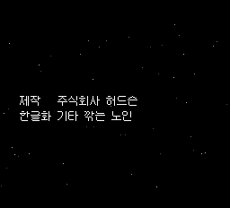
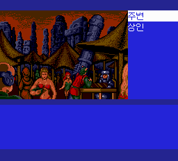
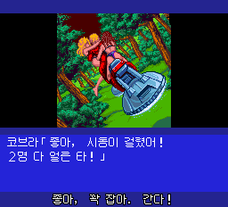
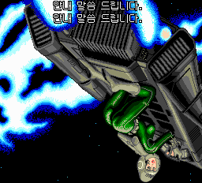

# PCE-Space-Adventure-Cobra-Kr

**스페이스 코브라 — 흑룡왕의 전설 · 비공식 한글화 정식 버전 v1.0**

PC Engine CD-ROM²용 SF 어드벤처입니다. 우주 해적 코브라가 되어 장면을 조사하고 인물과 대화하며 흑룡왕을 둘러싼 사건을 풀어갑니다. 원작의 일본어 음성과 음악을 유지하면서 대사·메뉴·엔딩에 12×12 한글을 적용하고 음성 자막을 추가했습니다.

**한글화: 기타 깎는 노인**

## 다운로드

**[v1.0 정식 릴리스 — Windows EXE 패처](https://github.com/OldManCraveGuitars-bit/PCE-Space-Adventure-Cobra-Kr/releases/tag/v1.0)**

- `PCE-Space-Adventure-Cobra-Kr-v1.0-Patcher.exe`: 별도 Python 설치 없이 실행하는 패처입니다.
- `PCE-Space-Adventure-Cobra-Kr-v1.0.zip`: 같은 EXE와 사용 안내·구성요소 라이선스를 묶었습니다.
- 원본 게임과 BIOS는 포함하지 않습니다. 일본판 원본 CHD 또는 단일 BIN/CUE가 필요합니다.

## 한글화 내용

- 원작 디자인을 바탕으로 타이틀·부제·크레딧을 한글화했습니다.
- 대사·선택지·엔딩 2,749개 기존 항목과 한글화 크레딧 1개에 12×12 한글을 적용했습니다. 공백은 반각 6픽셀입니다.
- 음성 재생 128개 이벤트에 자막 167개를 제공합니다. 줄마다 중앙 정렬하고 글자·윤곽선 밖은 투명하게 표시합니다.
- 선택지 847개를 한 줄에 맞추고 `통로로 복귀`, `생명유지장치`처럼 긴 문구를 정리했습니다.
- 원래 음성·음악을 보존하며 자막은 게임 내부에서 표시됩니다.

## v1.0 변경 사항

- 엔딩의 **‘제작 주식회사 허드슨’ 바로 아래에 ‘한글화 기타 깎는 노인’**을 추가했습니다.
- ‘자기 성의 노예로 삼으려고’ 음성을 한 줄씩 네 문구로 나누고 대사창 아래에 고정했습니다. 그림 표시 상태가 바뀌면서 자막이 화면 중간으로 올라가는 경로를 막았습니다.
- v0.87까지의 시장 ‘조사’ 정지, 방 밖 이동 정지, 저장·불러오기 안내 중복, 탈출 자막 겹침과 카지노 자막 누락 수정을 모두 포함합니다.
- 여학생 첫 음성·시민들의 두 번째 ‘도와줘요!’ 자막, 끝 글자 깨짐, 엔딩 잔상 등 기존 수정도 포함합니다.
- 소개·사용법·변경 내역을 정리하고 GitHub 정식 릴리스로 배포합니다. [전체 변경 내역](CHANGELOG.md)

## 적용 방법

1. EXE를 실행하고 **일본판 원본 CHD 또는 단일 BIN/CUE**를 선택합니다. 이전 한글판에 덧씌우지 않습니다.
2. 새 출력 폴더를 정한 뒤 **한국어 패치 만들기**를 누릅니다.
3. `CHD도 생성하기`를 선택하면 BIN/CUE와 CHD를 함께 만듭니다. 기존 파일은 덮어쓰지 않습니다.
4. 생성된 CHD 또는 CUE로 새로 부팅합니다. BIN과 CUE는 같은 폴더에 둡니다.

**Super CD-ROM² System Card 3.0**과 약 **900MB 이상의 여유 공간**이 필요합니다. 여러 BIN으로 나뉜 CUE는 직접 지원하지 않습니다.

이전 버전의 강제저장 상태 자동 로딩은 끄세요. 게임 내 저장은 이어서 사용할 수 있으며, 에뮬레이터에서 요구하는 저장 파일명을 새 게임 파일의 기본 이름과 맞춰야 합니다. 기존 저장 파일은 먼저 별도로 보관하세요.

지원 원본: `Space Adventure Cobra - Kokuryuuou no Densetsu (Japan)`

| 항목 | 값 |
| --- | --- |
| 원본 BIN 크기 | 252,291,984바이트 |
| 원본 BIN SHA-256 | `d724ebe0a12c1055dd41e496d135ea62f8b09bb30f8cc6313c6bf4b6fadb5e1a` |
| v1.0 결과 BIN SHA-256 | `519c6853163e5c172323692165bee73fb5958a6a9522d4ff7b88d7aac2bb873d` |

## 화면

| 엔딩 한글화 크레딧 | 시장 조사 메뉴 |
| --- | --- |
|  |  |
| 탈출 음성 자막 | 카지노 음성 자막 |
|  |  |

위 화면은 모두 v1.0 빌드에서 캡처했습니다. 엔딩은 원래 숨은 메뉴, 시장·탈출·카지노는 시험용 저장 진입 후 원래 메뉴로 확인했습니다.

## 검수와 제작 정보

새 부팅·오프닝, 엔딩 92개 필드, 선택지 847개의 실제 글자 픽셀, 시장 조사·이동, 주요 자막과 EXE의 원본 CHD/CUE 적용을 확인했습니다. [검수 범위와 남은 확인 사항](QA.md)을 참고하세요. 전 스토리 분기 완주·모든 실기 환경·사람의 전체 음성 청취 검수는 완료하지 않았습니다.

비공식 팬 한글화이며 원 제작사·권리자의 공식 제품이 아닙니다. 게임과 원작 자산의 권리는 각 권리자에게 있습니다. [외부 구성요소와 글꼴 안내](THIRD_PARTY_NOTICES.md)

패처 소스는 `tools/release_patcher.py`에 있습니다. `requirements-build.txt`를 설치하고 `tools/build-patcher.ps1`을 실행하면 동봉된 v1.0 패치 자료로 EXE를 다시 만들 수 있습니다.
