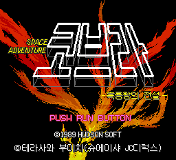
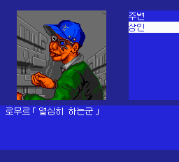
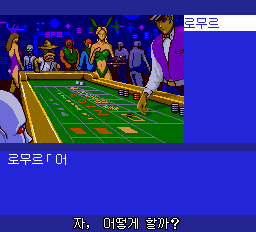
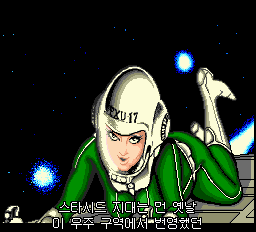
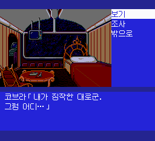
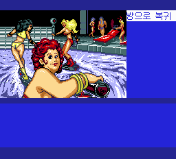
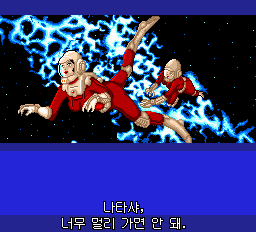
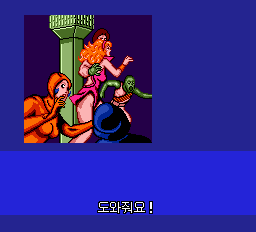
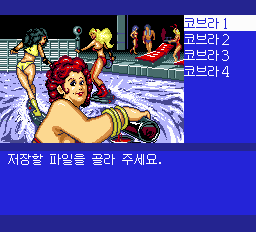

# PCE-Space-Adventure-Cobra-Kr

**스페이스 코브라 — 흑룡왕의 전설 · PC Engine CD-ROM² 한국어 패치 v0.87**

우주 해적 코브라가 등장하는 SF 어드벤처입니다. 장면을 조사하고 인물과 대화하며 사건을 풀어가는 작품으로, 대사와 음성 연출을 한국어로 즐길 수 있도록 작업했습니다.

## 다운로드

**[v0.87 릴리스 — Windows EXE 패처](https://github.com/OldManCraveGuitars-bit/PCE-Space-Adventure-Cobra-Kr/releases/tag/v0.87)**

- `PCE-Space-Adventure-Cobra-Kr-v0.87-Patcher.exe`: 별도 Python 설치 없이 실행합니다.
- ZIP에는 같은 EXE와 사용 안내·외부 구성요소 라이선스가 들어 있습니다.
- 일본판 원본 CHD 또는 단일 BIN/CUE가 필요합니다. 원본 게임과 BIOS는 포함하지 않습니다.

## v0.87 수정

- **시장에서 ‘조사’를 누르면 멈추던 문제를 수정했습니다.** ‘주변’과 ‘상인’ 선택지가 열리고 다음 행동으로 진행합니다.
- 메뉴의 이동 주소를 일본어 글자로 잘못 추출해 번역하던 오류가 원인이었습니다. 해당 가짜 텍스트 항목을 제외하고 원래 주소를 복원했습니다.
- 같은 오류를 막도록 추출·빌드 검사를 추가했습니다. 발견한 메뉴 테이블 926개, 항목 2,442개의 제어 바이트가 원본과 같은지 대조했습니다.
- v0.856의 탈출 자막 위치·카지노 자막 누락 수정과 v0.855의 저장·불러오기 안내 중복 수정도 포함합니다.

## 한글 패치 내용

- 원작 디자인을 바탕으로 타이틀·부제·크레딧을 한글화하고 `©1989 HUDSONSOFT`를 중앙 정렬했습니다.
- 등록 대사·선택지·엔딩 2,749개 항목에 12×12 한글을 적용했습니다. 공백은 반각 6픽셀입니다.
- 음성 자막 165개를 게임 내부에 추가했습니다. 줄별 중앙 정렬, 글자·윤곽선 밖 투명 표시를 지원합니다.
- 선택지 847개를 한 줄에 맞추고 `통로로 복귀`, `생명유지장치` 등 긴 표현을 정리했습니다.
- 끝 글자 깨짐, 엔딩 잔상, 방 밖 이동 정지, 검사 구간의 자막 그래픽 손상·떨림·감속을 수정했습니다.
- 여학생 첫 음성·시민의 두 번째 ‘도와줘요!’ 등 누락 자막과 연속 음성 대기 중 자막 중단을 수정했습니다.
- 원래 일본어 음성·음악을 보존합니다. [전체 변경 내역](CHANGELOG.md)을 참고하세요.

## 적용 방법

1. EXE를 실행하고 **일본판 원본 CHD 또는 단일 BIN/CUE**를 선택합니다. 이전 한국어판에 덧씌우지 않습니다.
2. 새 출력 폴더를 지정하고 **한국어 패치 만들기**를 누릅니다.
3. `CHD도 생성하기`를 선택하면 BIN/CUE와 CHD를 함께 만듭니다. 기존 파일은 덮어쓰지 않습니다.
4. 생성된 CHD 또는 CUE로 **전원을 다시 켜서 실행**합니다. BIN과 CUE는 같은 폴더에 둡니다.

**Super CD-ROM² System Card 3.0**이 필요합니다. 이전 에뮬레이터 세이브스테이트 자동 로딩을 끄세요. 게임 내 저장과 에뮬레이터 강제 저장은 서로 다릅니다. 출력 드라이브에 약 900MB 이상의 여유 공간이 필요합니다.

지원 원본: `Space Adventure Cobra - Kokuryuuou no Densetsu (Japan)`. 여러 BIN으로 나뉜 CUE는 직접 지원하지 않습니다. CHD는 압축 해제된 단일 BIN의 해시를 검사합니다.

| 구분 | 값 |
| --- | --- |
| 원본 BIN 크기 | 252,291,984바이트 |
| 원본 BIN SHA-256 | `d724ebe0a12c1055dd41e496d135ea62f8b09bb30f8cc6313c6bf4b6fadb5e1a` |
| v0.87 결과 BIN SHA-256 | `4e6f39541c3b8c87d72ec3c4538a57d7e25732acc249d83bc30021b0690d40f1` |

## 화면

| 시장 조사 메뉴 | 시장 상인 조사 |
| --- | --- |
|  |  |
| 탈출 자막 | 카지노 자막 |
|  |  |
| 오프닝 음성 자막 | 본편 대사 |
|  |  |
| 한 줄 선택지 | 여학생 첫 자막 |
|  |  |
| 시민들의 두 번째 도움 요청 | 저장 안내 수정 |
|  |  |

타이틀·시장·탈출·카지노는 v0.87 캡처입니다. 해당 장면은 시험용 저장 진입 후 원래 메뉴로 재현했습니다. 저장 안내는 v0.855, 나머지는 v0.85의 변경되지 않은 화면입니다.

## 검수 범위

시장 저장 불러오기, 조사 메뉴의 두 선택지, 대화·이동 메뉴와 바에서 카드 제시를 확인했습니다. 새 부팅·오프닝 진행, 탈출·카지노 자막의 연속 픽셀 검사와 EXE의 원본 CHD/CUE 적용도 통과했습니다. [검수 요약](QA.md)에 범위를 기록했습니다.

잘못 추출한 항목 하나를 제외한 나머지 번역 2,749개와 자막 원장·글꼴 매핑은 v0.856과 같습니다. 이전 [v0.85 전체 검수 기록](https://github.com/OldManCraveGuitars-bit/PCE-Space-Adventure-Cobra-Kr/blob/v0.85/QA.md)을 유지하며, 이번에 전부 반복하지 않았습니다.

시험판입니다. 전 스토리 분기 완주·모든 실기 환경·사람의 전체 음성 청취 검수는 완료하지 않았습니다.

## 패처 소스

`tools/release_patcher.py`와 `release/v0.87/patcher-assets/`로 다시 만들 수 있습니다. Python 환경에서 `requirements-build.txt`를 설치한 뒤 `tools/build-patcher.ps1`을 실행합니다.

[외부 구성요소와 글꼴 안내](THIRD_PARTY_NOTICES.md). 게임과 원작 자산의 권리는 각 권리자에게 있습니다.
